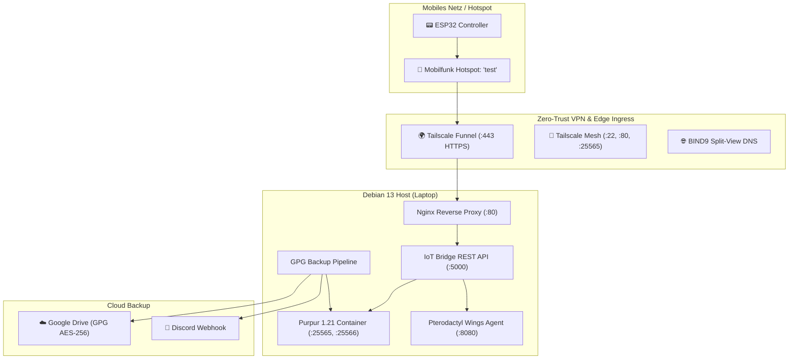

# 🎮 Minecraft IoT Infrastructure & Edge Ecosystem

[](https://debian.org)
[](https://purpurmc.org)
[](https://espressif.com)
[](https://tailscale.com)
[](https://www.isc.org/bind/)
[](https://gnupg.org)
[](LICENSE)

Dedizierter Linux-Host für Minecraft (Purpur 1.21) mit physischer ESP32-IoT-Fernbedienung, verschlüsselten Google-Drive-Backups und Zero-Trust-Netzwerk (Tailscale Funnel & BIND9 Split-View DNS).

---

## 🏗️ Architektur



---

## 🔌 Netzwerk & Port-Mapping

| Port / Protokoll | Dienst | Funktion |
| :--- | :--- | :--- |
| `53/UDP/TCP` | **BIND9 DNS** | Split-View: LAN liefert `192.168.0.33`, Tailscale liefert `100.111.45.61` |
| `80/TCP` | **Nginx** | Reverse-Proxy für Pterodactyl Panel und IoT-API `/api/status` |
| `443/HTTPS` | **Tailscale Funnel** | Weltweiter TLS-Zugriff (`https://prime.tail923f91.ts.net`) ohne offene Router-Ports |
| `5000/TCP` | **mc-control** | Python REST-Bridge (`/api/status`, `/start`, `/stop`, `/backup`) |
| `8080/TCP` | **Wings Agent** | Pterodactyl Container Daemon WebSocket API |
| `25565/TCP` | **Minecraft** | Purpur 1.21 Game-Traffic |
| `25566/TCP` | **RCON** | Lokales Servermanagement (TPS, Playerlist, Save-Lock) |

---

## 📟 ESP32 Hardware-Controller

```text
┌─────────────────────────────────┐
│ MINECRAFT STATUS    [●] ONLINE  │
│ ─────────────────────────────── │
│ TPS:   20.00 / 20.00    [GRÜN]  │
│ Spieler: 0 / 20                 │
│ PING:  34 ms         [HOTSPOT]  │
└─────────────────────────────────┘
```

### Pinbelegung
- **Display (SSD1306 OLED, I2C):** `SDA = GPIO 26`, `SCL = GPIO 25`
- **Taster (`INPUT_PULLUP` gegen GND):**
  - `GPIO 18`: Server starten
  - `GPIO 19`: Server stoppen
  - `GPIO 23`: Google-Drive-Backup auslösen
- **Ampel-LEDs (330 Ω gegen GND):**
  - `GPIO 27`: Grün (Server online & TPS ≥ 19.5)
  - `GPIO 14`: Gelb (Booting / Stoppen / TPS 17.0–19.4)
  - `GPIO 13`: Rot (Server offline oder TPS < 17.0)
- **Netzwerk:** Verbindet mit konfiguriertem 2,4 GHz Hotspot (WPA2). Erkennt Subnetz `10.x.x.x` und routet HTTPS direkt über Tailscale Funnel ohne TCP-SYN-Timeouts.

---

## 📦 Backup & Recovery

- **Zero-Downtime Save-Flush:** Sequenz `save-off` $\rightarrow$ `save-all flush` $\rightarrow$ `tar cvzf` $\rightarrow$ `save-on`. Verhindert inkonsistente Chunks.
- **Verschlüsselung:** Symmetrisch via `gpg --symmetric --cipher-algo AES-256`.
- **Cloud-Sync:** `rclone` mit 8 MB Chunks nach Google Drive. Lokale Retention: 5 Archive, Cloud: 14 Tage.
- **Zeitplan:** Täglicher Systemd-Timer um `03:30 Uhr` (`minecraft-backup.timer`).

---

## 🚀 Schnellstart & Diagnose

### 1. Gesamtsystem prüfen (16 Prüfpunkte)
```bash
./scripts/healthcheck.sh
```

### 2. Fernzugriff über SSH (Tailscale)
```bash
ssh prime@100.111.45.61
```

### 3. Server-Status manuell abfragen
```bash
curl -s https://prime.tail923f91.ts.net/api/status | jq .
```

### 4. Manuelles Cloud-Backup starten
```bash
/home/prime/minecraft-backup/backup.sh
```

### 5. Wiederherstellung
```bash
/home/prime/minecraft-backup/restore.sh
```

---

## 📂 Repository-Aufbau

```text
minecraft-iot-server/
├── README.md                 # Zentrale Systemdokumentation
├── scripts/healthcheck.sh    # Vollständige 16-Punkte Systemdiagnose
├── docs/                     # Architektur, Hardware, DNS & Troubleshoot-Guides
├── esp32-firmware/           # C++ Arduino Sketch (OLED, Buttons, Ampel, Funnel)
├── backend-bridge/           # Python REST API Bridge (Cgroups v2 RAM, Wings, RCON)
├── backup-pipeline/          # Save-Flush Backup, GPG AES-256, Rclone Sync & Timer
├── perf-monitoring/          # 20s Polling Daemon mit Discord Webhook Alerts
├── system-tuning/            # CPU Performance Governor & C-States Konfiguration
└── dns-bind9/                # BIND9 Split-View DNS Zonen (LAN & Tailscale)
```
