# Minecraft IoT Infrastructure & Server Ecosystem

Debian-basiertes Minecraft-Hostsystem mit physischer ESP32-Hardwareüberwachung, BIND9 Split-DNS, Tailscale Zero-Trust, automatisierten GPG-Backups und Reviactyl-Webpanel.

---

## Inhaltsverzeichnis
1. [Systemarchitektur](#1-systemarchitektur)
2. [Netzwerk & Port-Übersicht](#2-netzwerk--port-übersicht)
3. [Voraussetzungen](#3-voraussetzungen)
4. [Schritt-für-Schritt Installation](#4-schritt-für-schritt-installation)
   - [Phase 1: Host-System & Pakete](#phase-1-host-system--pakete)
   - [Phase 2: Reviactyl Panel & Wings Daemon](#phase-2-reviactyl-panel--wings-daemon)
   - [Phase 3: Panel Custom Extensions](#phase-3-panel-custom-extensions)
   - [Phase 4: BIND9 Split-DNS & Tailscale](#phase-4-bind9-split-dns--tailscale)
   - [Phase 5: IoT REST-Bridge & ESP32 Firmware](#phase-5-iot-rest-bridge--esp32-firmware)
   - [Phase 6: Backup-Pipeline & Google Drive Sync](#phase-6-backup-pipeline--google-drive-sync)
5. [Systemdiagnose](#5-systemdiagnose)
6. [Repository-Struktur](#6-repository-struktur)

---

## 1. Systemarchitektur

Klicke auf eine Komponente für den direkten Quellcode-Zugriff:

```mermaid
graph TD
    subgraph WAN ["Worldwide Access (Internet / 4G / 5G)"]
        UserPhone["Smartphone / Mobile Hotspot"]
        RemotePlayer["Remote Minecraft Client"]
    end

    subgraph Hardware ["IoT Hardware Controller"]
        ESP32["ESP32 Microcontroller"]
        OLED["SSD1306 128x64 OLED"]
        Ampel["3-Color Status LEDs (G/Y/R)"]
        Buttons["Hardware Taster (Start/Stop/Backup)"]
        ESP32 --> OLED
        ESP32 --> Ampel
        Buttons --> ESP32
    end

    subgraph Security ["Networking & Security Perimeter"]
        TailscaleMesh["Tailscale Mesh VPN (WireGuard)"]
        TailscaleFunnel["Tailscale Funnel (Public TLS Ingress)"]
        BindDNS["BIND9 DNS (Split-View & SRV)"]
    end

    subgraph Host ["Debian 13 Linux Host"]
        CPUOpt["CPU Governor (4.0 GHz Lock)"]

        subgraph CoreServices ["Backend & Daemons"]
            ControlBridge["mc-control-service.py (Port 5000 REST)"]
            PerfMonitor["mc-perf-monitor.py (Daemon)"]
            BackupService["Backup Pipeline (GPG AES-256)"]
            Panel["Reviactyl / Pterodactyl Panel (Nginx / PHP 8.3)"]
            MariaDB["MariaDB 10.x Database"]
        end

        subgraph Containers ["Docker Container Ecosystem"]
            Wings["Pterodactyl Wings Agent (Port 8080)"]
            MCServer["Purpur Minecraft 1.21.x Container\n(Port 25565 / RCON 25566)"]
        end
    end

    subgraph Cloud ["Cloud & Notification Services"]
        GDrive["Google Drive (Rclone Encrypted Storage)"]
        Discord["Discord Webhook (Rich Embed Alerts)"]
    end

    %% Connections
    ESP32 -->|"HTTPS Requests"| TailscaleFunnel
    TailscaleFunnel --> ControlBridge
    RemotePlayer --> BindDNS
    BindDNS --> TailscaleMesh
    TailscaleMesh --> MCServer

    ControlBridge -->|"RCON (TPS & Players)"| MCServer
    ControlBridge -->|"Cgroups RAM (30ms)"| MCServer
    ControlBridge -->|"Power Actions"| Wings
    ControlBridge -->|"Trigger Backup"| BackupService

    PerfMonitor -->|"RCON Polling"| MCServer
    PerfMonitor -->|"Alerts"| Discord

    BackupService -->|"RCON Save Lock"| MCServer
    BackupService -->|"mysqldump"| MariaDB
    BackupService -->|"Encrypted Upload"| GDrive
    BackupService -->|"Status Embeds"| Discord

    %% Clickable Links zur Implementierung & Installation
    click ESP32 href "esp32-firmware/MinecraftServerMonitor.ino" "ESP32 Firmware Source"
    click Buttons href "docs/HARDWARE_ESP32.md" "Hardware Schaltung & Taster"
    click OLED href "docs/HARDWARE_ESP32.md" "OLED Display Spezifikation"
    click Ampel href "docs/HARDWARE_ESP32.md" "LED Ampel Pinout"
    click BindDNS href "dns-bind9/named.conf.split-view.example" "BIND9 DNS Konfiguration"
    click TailscaleFunnel href "docs/TAILSCALE_SETUP.md" "Tailscale Funnel Setup"
    click TailscaleMesh href "docs/TAILSCALE_SETUP.md" "Tailscale Mesh VPN Setup"
    click CPUOpt href "system-tuning/set-cpu-performance.sh" "CPU Performance Lock Script"
    click ControlBridge href "backend-bridge/mc-control-service.py" "mc-control-service.py REST API"
    click PerfMonitor href "perf-monitoring/mc-perf-monitor.py" "Performance Monitor Daemon"
    click BackupService href "backup-pipeline/backup.sh" "Backup Pipeline Skript"
    click Panel href "#phase-2-reviactyl-panel--wings-daemon" "Pterodactyl / Reviactyl Panel Installation"
    click Wings href "docs/PTERODACTYL_NODE_WEBSOCKET_PNA.md" "Pterodactyl Wings Agent & WebSocket Fix"
    click MCServer href "scripts/healthcheck.sh" "Minecraft Server Health Check"
    click GDrive href "backup-pipeline/sync_gdrive_backups.py" "Google Drive Sync Engine"
    click Discord href "backup-pipeline/send_discord.py" "Discord Webhook Script"
```



---

## 2. Netzwerk & Port-Übersicht

| Port | Protokoll | Dienst | Schnittstelle | Funktion |
| :--- | :--- | :--- | :--- | :--- |
| `22` | TCP | OpenSSH | Tailscale / LAN | Terminal-Fernwartung |
| `53` | UDP/TCP | BIND9 DNS | Tailscale / LAN | Split-View DNS (`server.priyme`) |
| `80` | TCP | Nginx Webserver | 0.0.0.0 / Funnel | Reverse Proxy für Panel & REST-API |
| `443` | TCP | Tailscale Funnel | Internet | Öffentlicher HTTPS-Endpunkt ohne Port-Forwarding |
| `2022` | TCP | Wings SFTP | 0.0.0.0 | Dateiübertragung für Server-Dateien |
| `5000` | TCP | `mc-control` | 127.0.0.1 | REST-API für Hardware-Controller |
| `8080` | TCP | Wings Agent | 0.0.0.0 | Pterodactyl WebSocket API & Container-Steuerung |
| `25565` | TCP/UDP | Minecraft (Purpur) | 0.0.0.0 | Game Client Port |
| `25566` | TCP | Minecraft RCON | 127.0.0.1 | Lokale Verwaltung (TPS, Spieler, Save-Lock) |

---

## 3. Voraussetzungen

- **Host:** x86_64 PC/Server, 4 Kerne, 8 GB RAM, Debian 12/13.
- **Hardware-Controller:** ESP32 DevKit, 0.96" SSD1306 OLED (I2C), 3x LEDs (G/Y/R), 3x 330Ω Widerstände, 3x Taster.
- **Accounts:** Tailscale-Account, Google-Konto für Drive-Backups.

---

## 4. Schritt-für-Schritt Installation

### Phase 1: Host-System & Pakete

```bash
# 1. Systempakete installieren
sudo apt update && sudo apt install -y curl wget git jq tar gzip unzip gnupg lsb-release ca-certificates bind9 bind9utils nginx mariadb-server rclone python3 python3-pip

# 2. Docker installieren
curl -fsSL https://get.docker.com | sudo sh
sudo usermod -aG docker $USER

# 3. Tailscale einrichten
curl -fsSL https://tailscale.com/install.sh | sudo sh
sudo tailscale up --operator=$USER
```

---

### Phase 2: Reviactyl Panel & Wings Daemon

Details: [docs/PTERODACTYL_REVERSE_PROXY.md](docs/PTERODACTYL_REVERSE_PROXY.md) und [docs/PTERODACTYL_NODE_WEBSOCKET_PNA.md](docs/PTERODACTYL_NODE_WEBSOCKET_PNA.md).

```bash
# 1. MariaDB Datenbank anlegen
sudo mariadb -e "CREATE DATABASE panel; CREATE USER 'pterodactyl'@'127.0.0.1' IDENTIFIED BY 'DEIN_SICHERES_PASSWORT'; GRANT ALL PRIVILEGES ON panel.* TO 'pterodactyl'@'127.0.0.1' WITH GRANT OPTION; FLUSH PRIVILEGES;"

# 2. Panel installieren
sudo mkdir -p /var/www/pterodactyl && cd /var/www/pterodactyl
sudo cp .env.example .env
sudo composer install --no-dev --optimize-autoloader
sudo php artisan key:generate --force
sudo php artisan p:environment:setup
sudo php artisan p:environment:database
sudo php artisan migrate --seed --force
sudo chown -R www-data:www-data /var/www/pterodactyl

# 3. Nginx Reverse Proxy aktivieren
sudo cp dns-bind9/nginx/pterodactyl.conf.example /etc/nginx/sites-available/pterodactyl.conf
sudo ln -s /etc/nginx/sites-available/pterodactyl.conf /etc/nginx/sites-enabled/
sudo systemctl restart nginx

# 4. Wings Daemon starten
sudo systemctl enable --now agent.service

# 5. Node-FQDN Patch gegen Konsolen-Verbindungsfehler
sudo mariadb < backend-bridge/fix_node_fqdn.sql
sudo systemctl restart agent.service
```

---

### Phase 3: Panel Custom Extensions

Dokumentation: [panel-extensions/README.md](panel-extensions/README.md).

```bash
# Extensions ins Panel kopieren
sudo cp -r panel-extensions/mcjars-integration /var/www/pterodactyl/extensions/
sudo cp -r panel-extensions/modrinth-plugin-installer /var/www/pterodactyl/extensions/
sudo chown -R www-data:www-data /var/www/pterodactyl/extensions/
sudo chmod -R 755 /var/www/pterodactyl/extensions/

# Panel Cache leeren
cd /var/www/pterodactyl
sudo -u www-data php artisan route:clear
sudo -u www-data php artisan config:clear
sudo -u www-data php artisan view:clear
```
- **MCJars:** Wechsel zwischen 28 Server-Cores (Purpur, Paper, Velocity etc.).
- **Modrinth:** 1-Klick Installer für Plugins (Modrinth, SpigotMC, Hangar).

---

### Phase 4: BIND9 Split-DNS & Tailscale

Details: [docs/TAILSCALE_SETUP.md](docs/TAILSCALE_SETUP.md) und [dns-bind9/README.md](dns-bind9/README.md).

```bash
# 1. BIND9 Zonen kopieren und starten
sudo cp dns-bind9/named.conf.options /etc/bind/
sudo cp -r dns-bind9/zones/* /etc/bind/
sudo systemctl restart named

# 2. Tailscale Funnel für ESP32 Ingress aktivieren
tailscale funnel --bg 443 on
```
- LAN-Clients (`192.168.0.0/24`) erhalten `192.168.0.33`.
- VPN-Clients (`100.64.0.0/10`) erhalten `100.111.45.61`.

---

### Phase 5: IoT REST-Bridge & ESP32 Firmware

Hardware-Schaltplan: [docs/HARDWARE_ESP32.md](docs/HARDWARE_ESP32.md).

```bash
# 1. REST Bridge Dienst aktivieren
sudo cp backend-bridge/mc-control-service.py /usr/local/bin/mc-control-service.py
sudo chmod +x /usr/local/bin/mc-control-service.py
sudo cp backend-bridge/mc-control.service /etc/systemd/system/
sudo systemctl daemon-reload
sudo systemctl enable --now mc-control.service
```
2. **ESP32 flashen:**
   - Sketch [`esp32-firmware/MinecraftServerMonitor.ino`](esp32-firmware/MinecraftServerMonitor.ino) öffnen.
   - Tailscale Funnel URL und WLAN-Zugangsdaten anpassen.
   - Per Arduino IDE auf das Board laden (*ESP32 Dev Module*).

---

### Phase 6: Backup-Pipeline & Google Drive Sync

Details: [docs/BACKUP_PIPELINE.md](docs/BACKUP_PIPELINE.md) und [backup-pipeline/README.md](backup-pipeline/README.md).

```bash
# 1. Google Drive Remote anlegen
rclone config

# 2. Skripte kopieren
mkdir -p /home/prime/minecraft-backup
cp backup-pipeline/backup.sh /home/prime/minecraft-backup/
cp backup-pipeline/sync_gdrive_backups.py /home/prime/minecraft-backup/
cp backup-pipeline/backup.conf.example /home/prime/minecraft-backup/backup.conf
chmod +x /home/prime/minecraft-backup/*.sh /home/prime/minecraft-backup/*.py

# 3. Systemd Timer aktivieren
sudo cp backup-pipeline/systemd/minecraft-backup.service /etc/systemd/system/
sudo cp backup-pipeline/systemd/minecraft-backup.timer /etc/systemd/system/
sudo systemctl daemon-reload
sudo systemctl enable --now minecraft-backup.timer
sudo systemctl enable --now gdrive-backup-sync.timer
```

**Trigger-Möglichkeiten:**
- **Webpanel:** Im Tab **Backups** via `Create Backup`.
- **Hardware-Taster:** ESP32 GPIO 23 gegen GND (gelbe Status-LED).
- **Automatisch:** Täglich um 03:30 Uhr via Systemd-Timer.

---

## 5. Systemdiagnose

Automatischer 16-Punkte Test für Ports, Dienste, DNS, Proxy und Container:

```bash
./scripts/healthcheck.sh
```

---

## 6. Repository-Struktur

```text
minecraft-iot-server/
├── README.md                      # Zentrale Dokumentation & Bauanleitung
├── scripts/healthcheck.sh         # 16-Punkte Systemdiagnose
├── panel-extensions/              # Reviactyl Extensions (MCJars, Modrinth)
├── backend-bridge/                # REST API Bridge & Systemd Service
├── esp32-firmware/                # C++ Arduino Firmware für ESP32 Controller
├── backup-pipeline/               # GPG AES-256 Backup, Restore & Drive-Sync
├── dns-bind9/                     # Split-View DNS & Nginx VHost Konfiguration
├── perf-monitoring/               # TPS-Wächter & Discord Alerting Daemon
├── system-tuning/                 # CPU Governor (4.0 GHz Lock Script)
└── docs/                          # Architektur- & Setup-Spezifikationen
```
