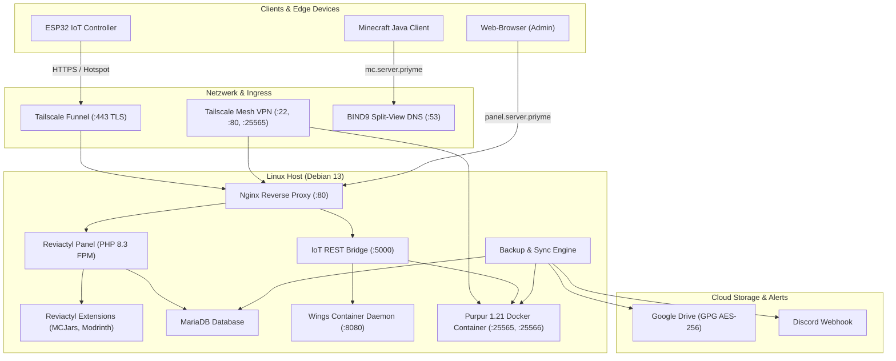

# Minecraft IoT Infrastructure & Game-Server Ecosystem

Ein vollständiger Leitfaden zur Bereitstellung eines eigenständigen Minecraft-Hostsystems auf Debian Linux mit physischer ESP32-Hardwareüberwachung, BIND9 Split-View DNS, Tailscale Zero-Trust-Netzwerk, automatisierten GPG-Backups und dem Reviactyl-Webpanel inklusive maßgeschneiderter Erweiterungen.

---

## Inhaltsverzeichnis
1. [Systemarchitektur](#1-systemarchitektur)
2. [Netzwerk & Port-Übersicht](#2-netzwerk--port-übersicht)
3. [Voraussetzungen & Basissystem](#3-voraussetzungen--basissystem)
4. [Schritt-für-Schritt Installationsanleitung](#4-schritt-für-schritt-installationsanleitung)
   - [Phase 1: Host-System & Abhängigkeiten](#phase-1-host-system--abhängigkeiten)
   - [Phase 2: Reviactyl Panel & Wings Daemon](#phase-2-reviactyl-panel--wings-daemon)
   - [Phase 3: Reviactyl Custom Extensions](#phase-3-reviactyl-custom-extensions)
   - [Phase 4: BIND9 Split-View DNS & Tailscale](#phase-4-bind9-split-view-dns--tailscale)
   - [Phase 5: IoT REST-Bridge & ESP32 Firmware](#phase-5-iot-rest-bridge--esp32-firmware)
   - [Phase 6: Backup-Pipeline & Google Drive Panel-Sync](#phase-6-backup-pipeline--google-drive-panel-sync)
5. [Systemdiagnose & Verifikation](#5-systemdiagnose--verifikation)
6. [Repository-Struktur](#6-repository-struktur)

---

## 1. Systemarchitektur

Das Gesamtsystem besteht aus sechs gekoppelten Teilsystemen:



---

## 2. Netzwerk & Port-Übersicht

| Port | Protokoll | Dienst | Schnittstelle | Funktion |
| :--- | :--- | :--- | :--- | :--- |
| `22` | TCP | OpenSSH Daemon | Tailscale / LAN | Sichere Terminal-Fernwartung |
| `53` | UDP/TCP | BIND9 DNS | Tailscale / LAN | Split-View DNS für `server.priyme` |
| `80` | TCP | Nginx Webserver | 0.0.0.0 / Funnel | Reverse Proxy für Panel & IoT-API |
| `443` | TCP | Tailscale Funnel | Öffentliches Internet | Weltweiter HTTPS-Endpunkt ohne Port-Forwarding |
| `2022` | TCP | Wings SFTP | 0.0.0.0 | Sicherer Dateiübertragungsdienst |
| `5000` | TCP | `mc-control` | 127.0.0.1 (Nginx) | Lokale REST-API für den ESP32 Controller |
| `8080` | TCP | Wings Agent | 0.0.0.0 | Pterodactyl Container Daemon WebSocket API |
| `25565` | TCP/UDP | Minecraft (Purpur) | 0.0.0.0 | Game Server Client Traffic |
| `25566` | TCP | Minecraft RCON | 127.0.0.1 | Lokale Administration (TPS, Spieler, Save-Lock) |

---

## 3. Voraussetzungen & Basissystem

- **Host-Hardware:** 64-Bit x86_64 PC oder Server (z. B. Laptop/Desktop), mind. 4 CPU-Kerne, 8 GB RAM, 64 GB SSD.
- **Betriebssystem:** Debian 13 (Trixie) oder Debian 12 (Bookworm) minimal.
- **Mikrocontroller:** ESP32 DevKit (ESP-WROOM-32), 0.96" SSD1306 I2C OLED (128x64), 3x LEDs (Grün, Gelb, Rot), 3x 330Ω Widerstände, 3x Taster.
- **Netzwerkzugang:** Internetverbindung, Tailscale-Account, Google-Account für Drive-Backups.

---

## 4. Schritt-für-Schritt Installationsanleitung

### Phase 1: Host-System & Abhängigkeiten

1. System aktualisieren und Basis-Pakete installieren:
   ```bash
   sudo apt update && sudo apt install -y curl wget git jq tar gzip unzip gnupg lsb-release ca-certificates bind9 bind9utils nginx mariadb-server rclone python3 python3-pip
   ```

2. Docker Engine und Container-Runtime einrichten:
   ```bash
   curl -fsSL https://get.docker.com | sudo sh
   sudo usermod -aG docker $USER
   ```

3. Tailscale Mesh VPN installieren:
   ```bash
   curl -fsSL https://tailscale.com/install.sh | sudo sh
   sudo tailscale up --operator=$USER
   ```

---

### Phase 2: Reviactyl Panel & Wings Daemon

Detaillierte Konfigurationen befinden sich unter [docs/PTERODACTYL_REVERSE_PROXY.md](docs/PTERODACTYL_REVERSE_PROXY.md).

1. Datenbank vorbereiten:
   ```sql
   CREATE DATABASE panel;
   CREATE USER 'pterodactyl'@'127.0.0.1' IDENTIFIED BY 'DEIN_SICHERES_PASSWORT';
   GRANT ALL PRIVILEGES ON panel.* TO 'pterodactyl'@'127.0.0.1' WITH GRANT OPTION;
   FLUSH PRIVILEGES;
   ```

2. Panel-Dateien installieren:
   ```bash
   sudo mkdir -p /var/www/pterodactyl
   cd /var/www/pterodactyl
   # Reviactyl Release herunterladen und entpacken
   sudo cp .env.example .env
   sudo composer install --no-dev --optimize-autoloader
   sudo php artisan key:generate --force
   sudo php artisan p:environment:setup
   sudo php artisan p:environment:database
   sudo php artisan migrate --seed --force
   sudo chown -R www-data:www-data /var/www/pterodactyl
   ```

3. Nginx Reverse Proxy konfigurieren:
   Beispielkonfiguration aus [dns-bind9/nginx/pterodactyl.conf.example](dns-bind9/nginx/pterodactyl.conf.example) nach `/etc/nginx/sites-available/pterodactyl.conf` kopieren und aktivieren:
   ```bash
   sudo ln -s /etc/nginx/sites-available/pterodactyl.conf /etc/nginx/sites-enabled/
   sudo systemctl restart nginx
   ```

4. Wings Daemon konfigurieren:
   Im Panel eine Node anlegen, Konfigurationsdatei nach `/etc/pterodactyl/config.yml` kopieren und Service starten:
   ```bash
   sudo systemctl enable --now agent.service
   ```

---

### Phase 3: Reviactyl Custom Extensions

Das Projekt beinhaltet zwei eigenentwickelte Erweiterungen unter [panel-extensions/](panel-extensions/):

1. **mcjars-integration (`Server Software`):**
   Erlaubt den Wechsel der Server-Software (Purpur, Paper, Fabric, Velocity etc. – 28 Versionen) direkt im Webpanel.
2. **modrinth-plugin-installer (`Plugins`):**
   Vollständiger 1-Klick Plugin-Manager mit nativer Anbindung an Modrinth, SpigotMC und Hangar.

Installation der Erweiterungen:
```bash
sudo cp -r panel-extensions/mcjars-integration /var/www/pterodactyl/extensions/
sudo cp -r panel-extensions/modrinth-plugin-installer /var/www/pterodactyl/extensions/
sudo chown -R www-data:www-data /var/www/pterodactyl/extensions/
sudo chmod -R 755 /var/www/pterodactyl/extensions/

# Cache des Panels leeren
cd /var/www/pterodactyl
sudo -u www-data php artisan route:clear
sudo -u www-data php artisan config:clear
sudo -u www-data php artisan view:clear
```

Weitere Details siehe [panel-extensions/README.md](panel-extensions/README.md).

---

### Phase 4: BIND9 Split-View DNS & Tailscale

Detaillierte Anleitung: [docs/TAILSCALE_SETUP.md](docs/TAILSCALE_SETUP.md) und [dns-bind9/README.md](dns-bind9/README.md).

1. BIND9 Split-View konfigurieren:
   - Lokale Clients (`192.168.0.0/24`) erhalten `192.168.0.33`.
   - VPN-Clients (`100.64.0.0/10`) erhalten `100.111.45.61`.
   - Vorlagen aus [dns-bind9/named.conf.options](dns-bind9/named.conf.options) und [dns-bind9/zones/](dns-bind9/zones/) nach `/etc/bind/` kopieren.
   ```bash
   sudo systemctl restart named
   ```

2. Tailscale Funnel für den ESP32 Ingress aktivieren:
   ```bash
   tailscale funnel --bg 443 on
   ```
   Ermöglicht weltweiten Zugriff auf `https://<dein-knoten>.ts.net/api/status` über Port 80 an Nginx weitergeleitet.

---

### Phase 5: IoT REST-Bridge & ESP32 Firmware

Hardware-Schaltpläne und Pinbelegungen siehe [docs/HARDWARE_ESP32.md](docs/HARDWARE_ESP32.md).

1. REST-Bridge Dienst einrichten:
   Dateien aus [backend-bridge/](backend-bridge/) kopieren und starten:
   ```bash
   sudo cp backend-bridge/mc-control-service.py /usr/local/bin/mc-control-service.py
   sudo chmod +x /usr/local/bin/mc-control-service.py
   sudo cp backend-bridge/mc-control.service /etc/systemd/system/
   sudo systemctl daemon-reload
   sudo systemctl enable --now mc-control.service
   ```

2. ESP32 Firmware flashen:
   - Sketch: [esp32-firmware/MinecraftServerMonitor.ino](esp32-firmware/MinecraftServerMonitor.ino)
   - In Zeile 48 die URL deines Tailscale Funnels eintragen.
   - In Zeile 615 WLAN-SSID und Passwort eintragen.
   - Über Arduino IDE auf den ESP32 laden (Board: *ESP32 Dev Module*).

---

### Phase 6: Backup-Pipeline & Google Drive Panel-Sync

Dokumentation: [docs/BACKUP_PIPELINE.md](docs/BACKUP_PIPELINE.md).

1. Rclone für Google Drive einrichten:
   ```bash
   rclone config
   # Remote 'gdrive' als Google Drive anlegen
   ```

2. Backup-Skript und Panel-Synchronisation einrichten:
   ```bash
   mkdir -p /home/prime/minecraft-backup
   cp backup-pipeline/backup.sh /home/prime/minecraft-backup/
   cp backup-pipeline/sync_gdrive_backups.py /home/prime/minecraft-backup/
   cp backup-pipeline/backup.conf.example /home/prime/minecraft-backup/backup.conf
   chmod +x /home/prime/minecraft-backup/*.sh /home/prime/minecraft-backup/*.py
   ```
   In `backup.conf` RCON-Passwort, GPG-Passphrase und Discord-Webhook eintragen.

3. Automatische Systemd-Timer aktivieren:
   ```bash
   sudo cp backup-pipeline/systemd/minecraft-backup.service /etc/systemd/system/
   sudo cp backup-pipeline/systemd/minecraft-backup.timer /etc/systemd/system/
   sudo systemctl daemon-reload
   sudo systemctl enable --now minecraft-backup.timer
   sudo systemctl enable --now gdrive-backup-sync.timer
   ```
   Backups werden täglich um 03:30 Uhr ausgeführt und alle 5 Minuten synchronisiert. Im Reviactyl-Webpanel unter dem Reiter **Backups** werden ausschließlich verifizierte Minecraft-Archive (`mc_backup_*.tar.gz.gpg`) gelistet.

---

## 5. Systemdiagnose & Verifikation

Das bereitgestellte Diagnosetool prüft alle 16 Teilsysteme automatisiert:

```bash
./scripts/healthcheck.sh
```

Prüfumfang:
- Systemd-Dienste (`named`, `nginx`, `agent`, `mc-control`, `tailscaled`).
- Offene Netzwerkports (`53`, `80`, `5000`, `8080`, `25565`).
- BIND9 Split-View DNS Auflösung (LAN vs. VPN).
- HTTP API Endpunkte (lokal `:5000/api/status` und Funnel `https://<knoten>.ts.net/api/status`).
- Status des Minecraft Docker-Containers.

---

## 6. Repository-Struktur

```text
minecraft-iot-server/
├── README.md                          # Zentrale Gesamtdokumentation und Bauanleitung
├── scripts/
│   └── healthcheck.sh                 # 16-Punkte Systemdiagnose
├── panel-extensions/                  # Maßgeschneiderte Reviactyl Extensions
│   ├── mcjars-integration/            # 28 Server-Software Distributionen im Panel wechseln
│   ├── modrinth-plugin-installer/     # 1-Klick Modrinth/Spigot/Hangar Plugin-Manager
│   └── README.md                      # Dokumentation zur Panel-Erweiterung
├── backend-bridge/                    # REST API Bridge für ESP32 Hardware
│   ├── mc-control-service.py          # Python Cgroups v2 & RCON Multiplexing Daemon
│   ├── mc-control.service             # Systemd Unit File
│   └── README.md                      # API-Endpunkte und Spezifikation
├── esp32-firmware/                    # C++ Arduino Firmware für den Controller
│   ├── MinecraftServerMonitor.ino     # Firmware (SSD1306 OLED, CP437, Ampel, Interrupts)
│   └── README.md                      # Hardware-Hinweise und Flash-Anleitung
├── backup-pipeline/                   # Disaster Recovery & Cloud-Backup
│   ├── backup.sh                      # Save-Flush, GPG AES-256 und Rclone Upload
│   ├── sync_gdrive_backups.py         # Google Drive Backup-Sync für das Webpanel
│   ├── restore.sh                     # Interaktive Wiederherstellung
│   ├── systemd/                       # Systemd Timer und Service Units
│   └── README.md                      # Backup-Optionen und Retention Policy
├── dns-bind9/                         # BIND9 Split-View DNS Konfiguration
│   ├── named.conf.options             # DNS-Optionen und Forwarder
│   ├── zones/                         # Split-View Zonendateien (LAN & Tailscale)
│   └── nginx/                         # Pterodactyl Reverse Proxy VHost Vorlage
├── perf-monitoring/                   # Performance Überwachung & Discord Alerts
│   ├── mc-perf-monitor.py             # 20s Polling Daemon mit gleitendem Durchschnitt
│   └── README.md                      # Schwellwerte und Konfiguration
├── system-tuning/                     # Linux Host Tuning
│   ├── set-cpu-performance.sh         # CPU Governor, 4.0 GHz Lock, C-States Off
│   └── README.md                      # Laptop-Server Optimierungen
└── docs/                              # Technische Detailberichte
    ├── ARCHITECTURE.md                # Systemarchitektur, Protokolle und Datenflüsse
    ├── HARDWARE_ESP32.md              # Verdrahtungspläne, Entprellung und Pinout
    ├── TAILSCALE_SETUP.md             # Zero-Trust VPN, Funnel Ingress und Split-DNS
    ├── BACKUP_PIPELINE.md             # Save-Flush Konsistenz und GPG Verschlüsselung
    └── LAGEBERICHT.md                 # Vollständiger Systemaudit und Funktionsprüfung
```
