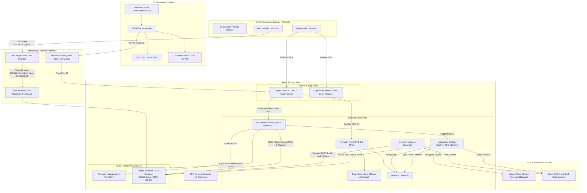

# System Architecture & Technical Specifications

Detaillierte Dokumentation der mehrschichtigen Systemarchitektur, Datenflüsse und Schnittstellen des Minecraft Server & IoT Ecosystems.

---

## 1. High-Level Architecture Diagram

---

## 2. Socket & Port Mapping

| Port | Protokoll | Service / Komponente | Erreichbarkeit | Zweck |
| :--- | :--- | :--- | :--- | :--- |
| **22** | TCP | OpenSSH Daemon | Tailscale (`100.x.y.z`) & LAN | Fernwartung der Konsole von überall |
| **53** | UDP/TCP | BIND9 DNS Server | Tailscale & LAN | Split-View DNS Auflösung (`server.priyme`) |
| **80** | TCP | Nginx Webserver | Alle Schnittstellen & Funnel | Reviactyl Webpanel & IoT Reverse Proxy |
| **443** | TCP | Nginx / Funnel TLS | LAN (`192.168.0.33`) & Funnel | HTTPS Ingress mit Let's Encrypt |
| **2022** | TCP | Wings SFTP Server | Alle Schnittstellen | Sicherer Datei-Upload/-Download |
| **5000** | TCP | `mc-control-service.py` | Localhost (Nginx Reverse Proxy) | REST API für ESP32 Hardware-Controller |
| **8080** | TCP | Reviactyl / Wings Agent | Alle Schnittstellen | WebSocket Live-Konsole & Node API |
| **25565** | TCP/UDP | Minecraft (Purpur 1.21) | Alle Schnittstellen (0.0.0.0) | Minecraft Game Client Port |
| **25566** | TCP | Minecraft RCON | Localhost (127.0.0.1) | Remote Console Befehle für Automatisierung |

---

## 3. Datenflüsse & Protokolle

### 1. IoT Monitoring & Control Loop
1. Der ESP32 verbindet sich mit dem vorkonfigurierten 2,4 GHz WLAN.
2. Alle 2500ms sendet er einen HTTP(S) GET Request an `/api/status`:
   - Befindet sich der ESP32 im Mobilfunknetz (`10.x.x.x`), routet er verzögerungsfrei direkt an den Tailscale Funnel (`https://<host>.ts.net/api/status`).
   - Im lokalen Netzwerk nutzt er die direkte LAN-Adresse (`http://192.168.0.33/api/status`).
3. Die Backend Control Bridge (`mc-control-service.py`) verarbeitet `/api/status`:
   - Ermittelt den Container-RAM direkt über Linux Cgroups v2 (`/sys/fs/cgroup/system.slice/docker-*.scope/memory.current`) in unter 30ms.
   - Fragt TPS und Spieler über eine gemultiplexte Single-Socket RCON-Verbindung ab.
   - Liefert kompaktes JSON zurück.
4. Der ESP32 aktualisiert das SSD1306 OLED-Display und setzt die LED-Ampel (Grün, Gelb, Rot).

### 2. Hardware Taster & Aktionen
- **Start (GPIO 18):** Löst `/start` aus -> Bridge ruft Wings Agent `/api/servers/{id}/power` auf (Action: `start`).
- **Stop (GPIO 19):** Löst `/stop` aus -> Bridge führt RCON `stop` aus und beendet den Container sauber über Wings.
- **Backup (GPIO 23):** Löst `/backup` aus -> Bridge startet `/home/prime/minecraft-backup/backup.sh` im Hintergrund.

### 3. Reviactyl Erweiterungen & Panel-Architektur
- **MCJars Integration:** Bindet sich in die Navigationsleiste des Servers ein und erlaubt das Umschalten zwischen 28 Server-Distributionen (Purpur, Paper, Velocity, Forge etc.) mit automatischem Core-Download.
- **Modrinth Plugin Installer:** Ermöglicht die direkte Installation von Plugins aus Modrinth, Spigot und Hangar in das Serververzeichnis `/plugins/`.
- **Google Drive Backup View:** Synchrone Anzeige aller verifizierten Minecraft-Backups aus Google Drive direkt im Webpanel.

### 4. Backup Pipeline & Datenkonsistenz
- RCON `save-off` gefolgt von `save-all flush` garantiert atomare Welt-Snapshots ohne inkonsistente Chunk-Grenzen.
- Hot-Dump der Panel-Datenbank via `mysqldump`.
- Archivierung und symmetrische clientseitige GPG-Verschlüsselung (AES-256).
- Rclone Upload nach Google Drive in 8 MB Chunks mit automatischer Quota-Absicherung.
- RCON `save-on` reaktiviert das automatische Speichern.
- `sync_gdrive_backups.py` gleicht Google Drive Archive mit der Panel-Datenbank ab.
