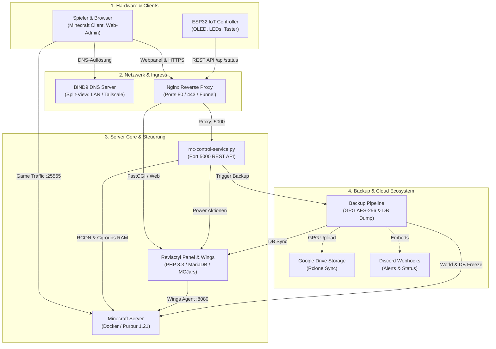

# System Architecture & Technical Specifications

Detaillierte Dokumentation der mehrschichtigen Systemarchitektur, Datenflüsse und Schnittstellen des Minecraft Server & IoT Ecosystems.

---

## 1. High-Level Architektur-Übersicht

Die Architektur ist in 4 klare, voneinander entkoppelte Schichten unterteilt. Jede Komponente ist direkt mit ihrer Quellcode-Implementierung verlinkt:

---

### Direkte Links zur Implementierung

Klicke auf eine Komponente, um direkt zum Quellcode bzw. zur Konfiguration im Repository zu gelangen:

| Komponente | Quelldatei / Implementierung | Dokumentation | Kurzbeschreibung |
| :--- | :--- | :--- | :--- |
| **ESP32 Firmware** | [`MinecraftServerMonitor.ino`](../esp32-firmware/MinecraftServerMonitor.ino) | [`esp32-firmware/README.md`](../esp32-firmware/README.md) | C++ Firmware für SSD1306 OLED, LEDs, WLAN & Hardware-Taster |
| **Hardware Pinout** | [`HARDWARE_ESP32.md`](./HARDWARE_ESP32.md) | [`HARDWARE_ESP32.md`](./HARDWARE_ESP32.md) | Pinbelegung (GPIOs), Schaltplan und Schaltungslogik |
| **REST Control Bridge** | [`mc-control-service.py`](../backend-bridge/mc-control-service.py) | [`backend-bridge/README.md`](../backend-bridge/README.md) | Leichtgewichtige REST API für Status, Cgroups RAM & RCON |
| **Systemd Bridge Service** | [`mc-control.service`](../backend-bridge/mc-control.service) | [`backend-bridge/README.md`](../backend-bridge/README.md) | Systemd Unit für den Hintergrunddienst auf Port 5000 |
| **Split-View DNS** | [`named.conf.split-view.example`](../dns-bind9/named.conf.split-view.example) | [`dns-bind9/README.md`](../dns-bind9/README.md) | BIND9 Split-DNS für dynamische Auflösung (LAN & Tailscale) |
| **Nginx Reverse Proxy** | [`pterodactyl.conf.example`](../dns-bind9/nginx/pterodactyl.conf.example) | [`PTERODACTYL_REVERSE_PROXY.md`](./PTERODACTYL_REVERSE_PROXY.md) | TLS-Terminierung, WebSocket-Proxying & Funnel-Weiterleitung |
| **Performance Daemon** | [`mc-perf-monitor.py`](../perf-monitoring/mc-perf-monitor.py) | [`perf-monitoring/README.md`](../perf-monitoring/README.md) | Tick-Rate- und TPS-Wächter mit Discord Webhook Alerts |
| **Backup Pipeline** | [`backup.sh`](../backup-pipeline/backup.sh) | [`backup-pipeline/README.md`](../backup-pipeline/README.md) | Atomarer RCON-Lock, MariaDB Dump, GPG AES-256 Verschlüsselung |
| **Google Drive Panel Sync**| [`sync_gdrive_backups.py`](../backup-pipeline/sync_gdrive_backups.py) | [`BACKUP_PIPELINE.md`](./BACKUP_PIPELINE.md) | Automatischer Abgleich der Google Drive Archive mit der Panel-DB |
| **Disaster Recovery** | [`restore.sh`](../backup-pipeline/restore.sh) | [`backup-pipeline/README.md`](../backup-pipeline/README.md) | Entschlüsselung und 1-Befehl-Wiederherstellung von Welt & DB |
| **Discord Benachrichtigung**| [`send_discord.py`](../backup-pipeline/send_discord.py) | [`backup-pipeline/README.md`](../backup-pipeline/README.md) | Webhook-Versand formatierter Embeds für Status & Fehler |
| **RCON CLI Client** | [`rcon_cli.py`](../backup-pipeline/rcon_cli.py) | [`backup-pipeline/README.md`](../backup-pipeline/README.md) | Eigenständige Python-RCON-Implementierung für Scripting |
| **Reviactyl MCJars** | [`mcjars-integration/`](../panel-extensions/mcjars-integration/) | [`panel-extensions/README.md`](../panel-extensions/README.md) | Panel Extension für 28 Minecraft Server-Cores |
| **Reviactyl Modrinth** | [`modrinth-plugin-installer/`](../panel-extensions/modrinth-plugin-installer/) | [`panel-extensions/README.md`](../panel-extensions/README.md) | 1-Klick Installer für Modrinth, Spigot & Hangar Plugins |
| **CPU Performance Lock** | [`set-cpu-performance.sh`](../system-tuning/set-cpu-performance.sh) | [`system-tuning/README.md`](../system-tuning/README.md) | Governor-Fixierung auf 4,0 GHz gegen Latenzspitzen |
| **System Health Check** | [`healthcheck.sh`](../scripts/healthcheck.sh) | [`scripts/healthcheck.sh`](../scripts/healthcheck.sh) | 16-Punkte Prüfskript für Ports, DNS, Proxy & Container |

---

## 2. Socket & Port Mapping

| Port | Protokoll | Service / Implementierung | Erreichbarkeit | Zweck |
| :--- | :--- | :--- | :--- | :--- |
| **22** | TCP | [OpenSSH Daemon](./TAILSCALE_SETUP.md) | Tailscale (`100.x.y.z`) & LAN | Fernwartung der Host-Konsole |
| **53** | UDP/TCP | [BIND9 DNS Server](../dns-bind9/named.conf.split-view.example) | Tailscale & LAN | Split-View DNS Auflösung (`server.priyme`) |
| **80** | TCP | [Nginx Webserver](../dns-bind9/nginx/pterodactyl.conf.example) | Alle Schnittstellen & Funnel | Reviactyl Webpanel & IoT Reverse Proxy |
| **443** | TCP | [Nginx TLS / Funnel Ingress](./TAILSCALE_SETUP.md) | LAN & Tailscale Funnel | Verschlüsselter HTTPS Ingress mit Let's Encrypt |
| **2022** | TCP | [Wings SFTP Server](./PTERODACTYL_REVERSE_PROXY.md) | Alle Schnittstellen | Sicherer Datei-Upload/-Download für Server-Files |
| **5000** | TCP | [`mc-control-service.py`](../backend-bridge/mc-control-service.py) | Localhost (Nginx Reverse Proxy) | REST API für Hardware-Controller & Webpanel |
| **8080** | TCP | [Reviactyl / Wings Agent](./PTERODACTYL_NODE_WEBSOCKET_PNA.md) | Alle Schnittstellen | WebSocket Live-Konsole & Node API |
| **25565** | TCP/UDP | [Minecraft Purpur Server](../scripts/healthcheck.sh) | Alle Schnittstellen (0.0.0.0) | Minecraft Game Client Port |
| **25566** | TCP | [Minecraft RCON](../backup-pipeline/rcon_cli.py) | Localhost (127.0.0.1) | Schnelle Remote-Befehle für Bridge & Backups |

---

## 3. Datenflüsse & Protokolle

### 1. IoT Monitoring & Control Loop
1. Der ESP32 verbindet sich mit dem vorkonfigurierten WLAN (siehe [`MinecraftServerMonitor.ino`](../esp32-firmware/MinecraftServerMonitor.ino)).
2. Alle 2500ms sendet er einen HTTP(S) GET Request an `/api/status`:
   - Befindet sich der ESP32 im Mobilfunknetz (`10.x.x.x`), routet er ohne TCP-Timeouts direkt über den Tailscale Funnel (`https://<host>.ts.net/api/status`).
   - Im lokalen Netzwerk nutzt er die direkte LAN-Adresse (`http://192.168.0.33/api/status`).
3. Die REST Control Bridge ([`mc-control-service.py`](../backend-bridge/mc-control-service.py)) verarbeitet `/api/status`:
   - Ermittelt den Container-RAM direkt über Linux Cgroups v2 (`/sys/fs/cgroup/system.slice/docker-*.scope/memory.current`) in unter 30ms.
   - Fragt TPS und aktive Spieler über eine gemultiplexte Single-Socket RCON-Verbindung ab.
   - Liefert kompaktes JSON zurück (`status`, `players`, `max_players`, `tps`, `ram_used_mb`).
4. Der ESP32 aktualisiert das SSD1306 Display und steuert die LED-Ampel (Grün = TPS ≥ 19.5, Gelb = TPS 15.0–19.4 / Backup aktiv, Rot = TPS < 15 oder Server offline).

### 2. Hardware-Taster & Aktions-Steuerung
- **Start (GPIO 18):** Sendet POST an `/start` -> Bridge ruft Wings Agent `/api/servers/{id}/power` auf (Action: `start`).
- **Stop (GPIO 19):** Sendet POST an `/stop` -> Bridge führt RCON `stop` aus und beendet den Container sauber über Wings.
- **Backup (GPIO 23):** Sendet POST an `/backup` -> Bridge startet die Pipeline ([`backup.sh`](../backup-pipeline/backup.sh)) im Hintergrund. Doppelte Klicks werden mit `409 Conflict` geblockt.

### 3. Reviactyl Erweiterungen & Panel-Architektur
- **MCJars Integration:** ([`panel-extensions/mcjars-integration/`](../panel-extensions/mcjars-integration/)) Bindet sich in die Navigationsleiste des Servers ein und erlaubt das Umschalten zwischen 28 Server-Distributionen (Purpur, Paper, Velocity, Forge etc.) mit automatischem Core-Download.
- **Modrinth Plugin Installer:** ([`panel-extensions/modrinth-plugin-installer/`](../panel-extensions/modrinth-plugin-installer/)) Ermöglicht die direkte Installation von Plugins aus Modrinth, Spigot und Hangar in das Serververzeichnis `/plugins/`.
- **Google Drive Backup Sync:** ([`sync_gdrive_backups.py`](../backup-pipeline/sync_gdrive_backups.py)) Synchrone Anzeige aller verifizierten Minecraft-Backups aus Google Drive direkt im Webpanel, inklusive Status-Synchronisation für Backups, die über den Webpanel-Tab gestartet wurden.

### 4. Backup Pipeline & Datenkonsistenz
- RCON `save-off` gefolgt von `save-all flush` garantiert atomare Welt-Snapshots ohne inkonsistente Chunk-Grenzen.
- Hot-Dump der Panel-Datenbank via `mysqldump` in [`backup.sh`](../backup-pipeline/backup.sh).
- Archivierung und symmetrische clientseitige GPG-Verschlüsselung (AES-256).
- Rclone Upload nach Google Drive in 8 MB Chunks mit automatischer Quota-Absicherung.
- RCON `save-on` reaktiviert das automatische Speichern.
- [`sync_gdrive_backups.py`](../backup-pipeline/sync_gdrive_backups.py) gleicht Google Drive Archive mit der MariaDB-Tabelle `panel.backups` ab.
- Wiederherstellung erfolgt über [`restore.sh`](../backup-pipeline/restore.sh) mit vollständiger Entschlüsselung und automatischem Import.
