# System Architecture & Technical Specifications

Übersicht über Architektur, Schnittstellen und Datenflüsse des Minecraft Server & IoT Ecosystems.

---

## 1. High-Level Architecture Diagram

Klicke auf eine Komponente im Diagramm oder nutze die [Tabelle](#direkte-links-zur-implementierung--installation) für den direkten Quellcode-Zugriff:

```mermaid
graph TD
    subgraph WAN ["Worldwide Access (Internet / 4G / 5G)"]
        UserPhone["Smartphone / Mobile Hotspot"]
        RemotePlayer["Remote Minecraft Client"]
    end

    subgraph Hardware ["IoT Hardware Controller"]
        ESP32["ESP32 Microcontroller"]
        OLED["SSD1306 128x64 OLED"]
        Ampel["3-Color Status LEDs (G/Y/R)"]
        Buttons["Hardware Taster (Start/Stop/Backup)"]
        ESP32 --> OLED
        ESP32 --> Ampel
        Buttons --> ESP32
    end

    subgraph Security ["Networking & Security Perimeter"]
        TailscaleMesh["Tailscale Mesh VPN (WireGuard)"]
        TailscaleFunnel["Tailscale Funnel (Public TLS Ingress)"]
        BindDNS["BIND9 DNS (Split-View & SRV)"]
    end

    subgraph Host ["Debian 13 Linux Host"]
        CPUOpt["CPU Governor (4.0 GHz Lock)"]

        subgraph CoreServices ["Backend & Daemons"]
            ControlBridge["mc-control-service.py (Port 5000 REST)"]
            PerfMonitor["mc-perf-monitor.py (Daemon)"]
            BackupService["Backup Pipeline (GPG AES-256)"]
            Panel["Reviactyl / Pterodactyl Panel (Nginx / PHP 8.3)"]
            MariaDB["MariaDB 10.x Database"]
        end

        subgraph Containers ["Docker Container Ecosystem"]
            Wings["Pterodactyl Wings Agent (Port 8080)"]
            MCServer["Purpur Minecraft 1.21.x Container\n(Port 25565 / RCON 25566)"]
        end
    end

    subgraph Cloud ["Cloud & Notification Services"]
        GDrive["Google Drive (Rclone Encrypted Storage)"]
        Discord["Discord Webhook (Rich Embed Alerts)"]
    end

    %% Connections
    ESP32 -->|"HTTPS Requests"| TailscaleFunnel
    TailscaleFunnel --> ControlBridge
    RemotePlayer --> BindDNS
    BindDNS --> TailscaleMesh
    TailscaleMesh --> MCServer

    ControlBridge -->|"RCON (TPS & Players)"| MCServer
    ControlBridge -->|"Cgroups RAM (30ms)"| MCServer
    ControlBridge -->|"Power Actions"| Wings
    ControlBridge -->|"Trigger Backup"| BackupService

    PerfMonitor -->|"RCON Polling"| MCServer
    PerfMonitor -->|"Alerts"| Discord

    BackupService -->|"RCON Save Lock"| MCServer
    BackupService -->|"mysqldump"| MariaDB
    BackupService -->|"Encrypted Upload"| GDrive
    BackupService -->|"Status Embeds"| Discord

    %% Clickable Links zur Implementierung & Installation auf GitHub
    click ESP32 href "../esp32-firmware/MinecraftServerMonitor.ino" "ESP32 Firmware Source"
    click Buttons href "./HARDWARE_ESP32.md" "Hardware Schaltung & Taster"
    click OLED href "./HARDWARE_ESP32.md" "OLED Display Spezifikation"
    click Ampel href "./HARDWARE_ESP32.md" "LED Ampel Pinout"
    click BindDNS href "../dns-bind9/named.conf.split-view.example" "BIND9 DNS Konfiguration"
    click TailscaleFunnel href "./TAILSCALE_SETUP.md" "Tailscale Funnel Setup"
    click TailscaleMesh href "./TAILSCALE_SETUP.md" "Tailscale Mesh VPN Setup"
    click CPUOpt href "../system-tuning/set-cpu-performance.sh" "CPU Performance Lock Script"
    click ControlBridge href "../backend-bridge/mc-control-service.py" "mc-control-service.py REST API"
    click PerfMonitor href "../perf-monitoring/mc-perf-monitor.py" "Performance Monitor Daemon"
    click BackupService href "../backup-pipeline/backup.sh" "Backup Pipeline Skript"
    click Panel href "../README.md#phase-2-reviactyl-panel--wings-daemon" "Pterodactyl / Reviactyl Panel Installation & Setup"
    click Wings href "./PTERODACTYL_NODE_WEBSOCKET_PNA.md" "Pterodactyl Wings Agent & WebSocket Setup"
    click MCServer href "../scripts/healthcheck.sh" "Minecraft Server Health Check"
    click GDrive href "../backup-pipeline/sync_gdrive_backups.py" "Google Drive Sync Engine"
    click Discord href "../backup-pipeline/send_discord.py" "Discord Webhook Script"
```

---

### Direkte Links zur Implementierung & Installation

| Komponente | Quelldatei / Implementierung | Dokumentation & Installation | Kurzbeschreibung |
| :--- | :--- | :--- | :--- |
| **Installation (Gesamt)** | [`README.md`](../README.md#4-schritt-für-schritt-installationsanleitung) | [`README.md`](../README.md) | Schritt-für-Schritt Anleitung (Phasen 1–6) |
| **Panel (Pterodactyl)** | [`/var/www/pterodactyl`](../README.md#phase-2-reviactyl-panel--wings-daemon) | [`PTERODACTYL_REVERSE_PROXY.md`](./PTERODACTYL_REVERSE_PROXY.md) | Webinterface, Multi-Domain Reverse Proxy & Laravel Asset Fix |
| **Wings Daemon** | [`agent.service`](../README.md#phase-2-reviactyl-panel--wings-daemon) | [`PTERODACTYL_NODE_WEBSOCKET_PNA.md`](./PTERODACTYL_NODE_WEBSOCKET_PNA.md) | Container-Laufzeitumgebung & WebSocket Live-Konsole (:8080) |
| **Node FQDN Fix** | [`fix_node_fqdn.sql`](../backend-bridge/fix_node_fqdn.sql) | [`PTERODACTYL_NODE_WEBSOCKET_PNA.md`](./PTERODACTYL_NODE_WEBSOCKET_PNA.md) | SQL-Patch zur Behebung des roten Konsolen-Balkens |
| **Nginx VHost** | [`pterodactyl.conf.example`](../dns-bind9/nginx/pterodactyl.conf.example) | [`PTERODACTYL_REVERSE_PROXY.md`](./PTERODACTYL_REVERSE_PROXY.md) | Reverse Proxy VHost für Port 80, 443 & Funnel |
| **MCJars Extension** | [`mcjars-integration/`](../panel-extensions/mcjars-integration/) | [`panel-extensions/README.md`](../panel-extensions/README.md) | Panel Extension für 28 Minecraft Cores |
| **Modrinth Extension** | [`modrinth-plugin-installer/`](../panel-extensions/modrinth-plugin-installer/) | [`panel-extensions/README.md`](../panel-extensions/README.md) | 1-Klick Plugin Installer (Modrinth, Spigot, Hangar) |
| **ESP32 Firmware** | [`MinecraftServerMonitor.ino`](../esp32-firmware/MinecraftServerMonitor.ino) | [`esp32-firmware/README.md`](../esp32-firmware/README.md) | C++ Firmware für OLED, LEDs, WLAN & Taster |
| **Hardware Pinout** | [`HARDWARE_ESP32.md`](./HARDWARE_ESP32.md) | [`HARDWARE_ESP32.md`](./HARDWARE_ESP32.md) | GPIO-Belegung, Schaltplan und Entprellung |
| **REST Control Bridge** | [`mc-control-service.py`](../backend-bridge/mc-control-service.py) | [`backend-bridge/README.md`](../backend-bridge/README.md) | REST API für Serverstatus, Cgroups RAM & RCON |
| **Systemd Service** | [`mc-control.service`](../backend-bridge/mc-control.service) | [`backend-bridge/README.md`](../backend-bridge/README.md) | Daemon Unit File auf Port 5000 |
| **Split-View DNS** | [`named.conf.split-view.example`](../dns-bind9/named.conf.split-view.example) | [`dns-bind9/README.md`](../dns-bind9/README.md) | BIND9 Split-DNS für LAN und Tailscale |
| **Performance Daemon** | [`mc-perf-monitor.py`](../perf-monitoring/mc-perf-monitor.py) | [`perf-monitoring/README.md`](../perf-monitoring/README.md) | TPS- & Crash-Wächter mit Discord Alerts |
| **Backup Pipeline** | [`backup.sh`](../backup-pipeline/backup.sh) | [`backup-pipeline/README.md`](../backup-pipeline/README.md) | RCON Freeze, MariaDB Dump, GPG AES-256 Upload |
| **Google Drive Sync** | [`sync_gdrive_backups.py`](../backup-pipeline/sync_gdrive_backups.py) | [`BACKUP_PIPELINE.md`](./BACKUP_PIPELINE.md) | Automatischer Abgleich der Cloud-Backups mit der Panel-DB |
| **Disaster Recovery** | [`restore.sh`](../backup-pipeline/restore.sh) | [`backup-pipeline/README.md`](../backup-pipeline/README.md) | Entschlüsselung und Wiederherstellung von Welt & DB |
| **Discord Benachrichtigung**| [`send_discord.py`](../backup-pipeline/send_discord.py) | [`backup-pipeline/README.md`](../backup-pipeline/README.md) | Webhook Rich Embeds für Status & Fehler |
| **RCON CLI Client** | [`rcon_cli.py`](../backup-pipeline/rcon_cli.py) | [`backup-pipeline/README.md`](../backup-pipeline/README.md) | Python RCON-Client für Scripting |
| **CPU Performance Lock**| [`set-cpu-performance.sh`](../system-tuning/set-cpu-performance.sh) | [`system-tuning/README.md`](../system-tuning/README.md) | 4,0 GHz Governor Lock gegen Tick-Drops |
| **System Health Check** | [`healthcheck.sh`](../scripts/healthcheck.sh) | [`scripts/healthcheck.sh`](../scripts/healthcheck.sh) | 16-Punkte Diagnosetest für alle Komponenten |

---

## 2. Socket & Port Mapping

| Port | Protokoll | Service / Implementierung | Erreichbarkeit | Zweck |
| :--- | :--- | :--- | :--- | :--- |
| **22** | TCP | [OpenSSH Daemon](./TAILSCALE_SETUP.md) | Tailscale (`100.x.y.z`) & LAN | Fernwartung der Host-Konsole |
| **53** | UDP/TCP | [BIND9 DNS Server](../dns-bind9/named.conf.split-view.example) | Tailscale & LAN | Split-View DNS Auflösung (`server.priyme`) |
| **80** | TCP | [Panel & Nginx](../README.md#phase-2-reviactyl-panel--wings-daemon) | Alle Schnittstellen & Funnel | Webinterface & Reverse Proxy |
| **443** | TCP | [Nginx TLS / Funnel](./TAILSCALE_SETUP.md) | LAN & Tailscale Funnel | Verschlüsselter HTTPS Ingress mit Let's Encrypt |
| **2022** | TCP | [Wings SFTP](./PTERODACTYL_REVERSE_PROXY.md) | Alle Schnittstellen | Sicherer Dateiübertragungsdienst |
| **5000** | TCP | [`mc-control-service.py`](../backend-bridge/mc-control-service.py) | Localhost (Nginx Reverse Proxy) | REST API für Hardware-Controller & Webpanel |
| **8080** | TCP | [Wings Agent API](./PTERODACTYL_NODE_WEBSOCKET_PNA.md) | Alle Schnittstellen | WebSocket Live-Konsole & Node API |
| **25565** | TCP/UDP | [Minecraft Purpur Server](../scripts/healthcheck.sh) | Alle Schnittstellen (0.0.0.0) | Game Server Client Port |
| **25566** | TCP | [Minecraft RCON](../backup-pipeline/rcon_cli.py) | Localhost (127.0.0.1) | Schnelle Remote-Befehle für Bridge & Backups |

---

## 3. Datenflüsse & Protokolle

### 1. IoT Status-Loop
1. **Abfrage:** ESP32 pollt alle 2500 ms `/api/status` (Hotspot: Tailscale Funnel HTTPS, LAN: Direkt-IP `192.168.0.33`).
2. **Bridge:** [`mc-control-service.py`](../backend-bridge/mc-control-service.py) liest RAM via Cgroups v2 (<30 ms) und TPS/Spieler via Single-Socket RCON.
3. **Ausgabe:** ESP32 rendert SSD1306 OLED und setzt Ampel (Grün: TPS ≥ 19.5, Gelb: 15.0–19.4 / Backup, Rot: < 15 oder Offline).

### 2. Hardware-Taster
- **Start (GPIO 18):** POST an `/start` -> Wings Agent startet Container.
- **Stop (GPIO 19):** POST an `/stop` -> RCON `stop` und Container-Shutdown via Wings.
- **Backup (GPIO 23):** POST an `/backup` -> Startet [`backup.sh`](../backup-pipeline/backup.sh). Doppel-Klicks werden mit `409 Conflict` geblockt.

### 3. Panel & Extensions
- **Panel & Wings Setup:** Siehe [Installationsanleitung Phase 2](../README.md#phase-2-reviactyl-panel--wings-daemon).
- **Reverse Proxy & Ingress:** [PTERODACTYL_REVERSE_PROXY.md](./PTERODACTYL_REVERSE_PROXY.md) verhindert Mixed-Content unter Funnel.
- **Konsole & WebSocket:** [PTERODACTYL_NODE_WEBSOCKET_PNA.md](./PTERODACTYL_NODE_WEBSOCKET_PNA.md) mit SQL-Fix [`fix_node_fqdn.sql`](../backend-bridge/fix_node_fqdn.sql).
- **MCJars Extension:** ([`mcjars-integration/`](../panel-extensions/mcjars-integration/)) Core-Wechsel für 28 Versionen.
- **Modrinth Extension:** ([`modrinth-plugin-installer/`](../panel-extensions/modrinth-plugin-installer/)) 1-Klick Plugin-Installer.
- **Google Drive Sync:** ([`sync_gdrive_backups.py`](../backup-pipeline/sync_gdrive_backups.py)) Zeigt Drive-Backups im Panel und aktualisiert den Backup-Tab.

### 4. Backup Pipeline
1. **Freeze:** RCON `save-off` + `save-all flush` friert Chunks atomar ein.
2. **Dump:** `mysqldump` sichert die MariaDB-Datenbank.
3. **Crypto:** `tar.gz` Archiv + symmetrische GPG AES-256 Verschlüsselung.
4. **Upload:** Rclone lädt Archiv nach Google Drive (8 MB Chunks).
5. **Reaktivierung:** RCON `save-on` aktiviert Autosave wieder.
6. **Sync:** [`sync_gdrive_backups.py`](../backup-pipeline/sync_gdrive_backups.py) gleicht Drive-Backups mit der Panel-DB ab.
7. **Restore:** [`restore.sh`](../backup-pipeline/restore.sh) entschlüsselt und stellt Welt und DB wieder her.
