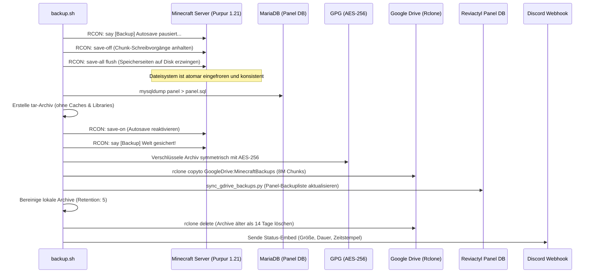

# Backup Pipeline & Disaster Recovery Spezifikation

Detaillierte Dokumentation der automatisierten Backup-Architektur, Datenkonsistenzgarantien, clientseitigen Verschlüsselung und Reviactyl-Integration.

---

## 1. Konsistenzgarantie: Der Save-Flush Zyklus

Minecraft-Server halten Welt-Zustände, Entity-Daten und Spielerinventare im Arbeitsspeicher und schreiben Chunks asynchron auf die Festplatte. Ein direktes Kopieren des Dateisystems ohne Synchronisation führt zu inkonsistenten Chunk-Grenzen (World Tearing).

Zur Vermeidung führt die Backup-Pipeline eine unterbrechungsfreie 3-Phasen-Sperre über RCON aus:



---

## 2. Sicherheit: Clientseitige GPG AES-256 Verschlüsselung

In fremden Cloud-Speichern abgelegte Daten sind bei kompromittierten Zugangsdaten gefährdet. Daher verschlüsselt die Pipeline alle Archive symmetrisch vor dem Upload:
- Befehl: `gpg --batch --yes --symmetric --cipher-algo AES256 --passphrase "$GPG_PASSPHRASE" ...`
- Dateiformat: `mc_backup_YYYY-MM-DD_HH-MM-SS.tar.gz.gpg`
- Weltdateien, Spielerdaten und MariaDB-Dumps sind ohne die Passphrase nicht lesbar.

---

## 3. Reviactyl Panel-Synchronisation

Damit autorisierte Administratoren Google Drive Backups direkt im Webpanel einsehen können:
- [`sync_gdrive_backups.py`](../backup-pipeline/sync_gdrive_backups.py) fragt `rclone lsl gdrive:MinecraftBackups/` ab.
- Filtert strikt nach `^mc_backup_.*\.tar\.gz\.gpg$` (ausschließlich echte Minecraft-Backups).
- Trägt Größe, Zeitstempel und Checksum-Hinweis `Google Drive (GPG AES-256)` in die Panel-Tabelle `backups` ein.
- Wird automatisch nach jedem Backup sowie alle 5 Minuten über den Systemd-Timer `gdrive-backup-sync.timer` ausgeführt.

---

## 4. Disaster Recovery & Wiederherstellung

### 1. Verfügbare Backups auflisten
```bash
/home/prime/minecraft-backup/restore.sh --list
```
Zeigt alle lokal und auf Google Drive vorhandenen Archive an.

### 2. Wiederherstellen aus der Cloud
```bash
# Bestimmtes Backup aus Google Drive herunterladen:
/home/prime/minecraft-backup/restore.sh --download mc_backup_2026-10-09_17-46-42.tar.gz.gpg

# Archiv entpacken und optional Datenbanken einspielen:
sudo /home/prime/minecraft-backup/restore.sh /home/prime/backups/mc_backup_2026-10-09_17-46-42.tar.gz.gpg --restore-db
```

### 3. Trockenlauf (Dry-Run)
Zur Überprüfung der Pipeline ohne Schreibvorgänge:
```bash
/home/prime/minecraft-backup/backup.sh --dry-run
```
