# Backup Pipeline & Disaster Recovery Spezifikation

Detaillierte Dokumentation der automatisierten Backup-Architektur, Datenkonsistenzgarantien, clientseitigen Verschlüsselung und Reviactyl-Integration.

---

## 1. Übersicht & Pipeline-Ablauf

Die Pipeline sichert Welt- und Datenbankdaten atomar, verschlüsselt das Archiv clientseitig und synchronisiert das Ergebnis automatisch mit Google Drive und dem Reviactyl-Webpanel:

```mermaid
graph LR
    Trigger["Start-Trigger<br/>(Panel / ESP32 / Timer)"] --> Step1["1. Konsistenz-Sperre<br/>RCON save-off & flush"]
    Step1 --> Step2["2. Dump & Bundle<br/>mysqldump + tar Archiv"]
    Step2 --> Step3["3. Verschlüsselung<br/>GPG AES-256 Symmetrisch"]
    Step3 --> Step4["4. Cloud-Sync<br/>Google Drive & Panel DB"]

    %% Clickable Links zur Implementierung
    click Trigger href "../backend-bridge/mc-control-service.py" "Trigger Endpunkte in mc-control-service.py"
    click Step1 href "../backup-pipeline/backup.sh" "RCON Save-Lock in backup.sh"
    click Step2 href "../backup-pipeline/backup.sh" "mysqldump und tar in backup.sh"
    click Step3 href "../backup-pipeline/backup.sh" "GPG Verschlüsselung in backup.sh"
    click Step4 href "../backup-pipeline/sync_gdrive_backups.py" "Google Drive Sync Engine in sync_gdrive_backups.py"
```



---

### Direkte Links zur Implementierung

| Schritt | Skript / Datei | Funktion |
| :--- | :--- | :--- |
| **Start-Trigger** | [`mc-control-service.py`](../backend-bridge/mc-control-service.py) | `/backup`-Endpunkt (Webpanel & ESP32 Taster GPIO 23) |
| **Backup-Hauptskript** | [`backup.sh`](../backup-pipeline/backup.sh) | RCON Freeze, MariaDB-Dump, Archivierung, GPG & Upload |
| **Wiederherstellung** | [`restore.sh`](../backup-pipeline/restore.sh) | 1-Klick Restore aus Google Drive oder lokalem Archiv |
| **Google Drive Panel-Sync** | [`sync_gdrive_backups.py`](../backup-pipeline/sync_gdrive_backups.py) | Automatischer Abgleich der Google Drive Backups mit MariaDB |
| **Discord Benachrichtigung** | [`send_discord.py`](../backup-pipeline/send_discord.py) | Rich Embed Statusberichte nach erfolgreichem Upload |
| **Systemd Automatisierung** | [`minecraft-backup.timer`](../backup-pipeline/systemd/minecraft-backup.timer) | Täglicher automatischer Lauf um 03:30 Uhr |

---

## 2. Konsistenzgarantie: Der Save-Flush Zyklus

Minecraft-Server halten Welt-Zustände, Entity-Daten und Spielerinventare im Arbeitsspeicher und schreiben Chunks asynchron auf die Festplatte. Ein unkoordiniertes Kopieren führt zu inkonsistenten Chunk-Grenzen (World Tearing).

Zur Vermeidung führt [`backup.sh`](../backup-pipeline/backup.sh) eine 3-Phasen-Sperre über RCON aus:
1. `save-off`: Unterbricht temporär das automatische Schreiben von Chunks.
2. `save-all flush`: Erzwingt das sofortige Schreiben aller im RAM befindlichen Speicherseiten auf die Festplatte. Das Dateisystem ist atomar eingefroren.
3. `mysqldump`: Sichert die MariaDB-Datenbank der Serververwaltung.
4. `save-on`: Sobald das tar-Archiv gelesen wurde, wird Autosave sofort reaktiviert, sodass der Serverbetrieb ungestört weiterläuft.

---

## 3. Sicherheit: Clientseitige GPG AES-256 Verschlüsselung

Archive werden noch vor dem Verlassen des Servers lokal symmetrisch verschlüsselt:
- **Verschlüsselungsbefehl:**
  ```bash
  gpg --batch --yes --symmetric --cipher-algo AES256 --passphrase "$GPG_PASSPHRASE" -o archive.tar.gz.gpg archive.tar.gz
  ```
- **Dateiformat:** `mc_backup_YYYY-MM-DD_HH-MM-SS.tar.gz.gpg`
- Selbst bei unberechtigtem Zugriff auf das Google Drive bleiben Weltdateien, Spielerdaten und Datenbank-Dumps geschützt.

---

## 4. Reviactyl Panel-Synchronisation

Damit autorisierte Administratoren Google Drive Backups direkt im Webpanel einsehen und verwalten können:
- [`sync_gdrive_backups.py`](../backup-pipeline/sync_gdrive_backups.py) fragt Google Drive via Rclone ab.
- Filtert strikt nach `^mc_backup_.*\.tar\.gz\.gpg$` (nur echte Minecraft-Archive).
- Löst ausstehende Web-Panel Backups (Status-Spinner) automatisch auf, sobald der Upload abgeschlossen ist.
- Trägt Größe, Zeitstempel und Checksum-Hinweis `Google Drive (GPG AES-256)` in die Panel-Tabelle `backups` ein.
- Läuft nach jedem Backup sowie alle 5 Minuten per Systemd-Timer.

---

## 5. Disaster Recovery & Wiederherstellung

### 1. Verfügbare Backups auflisten
```bash
/home/prime/minecraft-backup/restore.sh --list
```
Zeigt alle lokal und auf Google Drive vorhandenen Archive an.

### 2. Wiederherstellen aus der Cloud
```bash
# Bestimmtes Backup aus Google Drive herunterladen:
/home/prime/minecraft-backup/restore.sh --download mc_backup_2026-10-09_17-46-42.tar.gz.gpg

# Archiv entpacken und Datenbank einspielen:
sudo /home/prime/minecraft-backup/restore.sh /home/prime/backups/mc_backup_2026-10-09_17-46-42.tar.gz.gpg --restore-db
```

### 3. Trockenlauf (Dry-Run)
Zur Überprüfung der Pipeline ohne Schreibvorgänge:
```bash
/home/prime/minecraft-backup/backup.sh --dry-run
```
